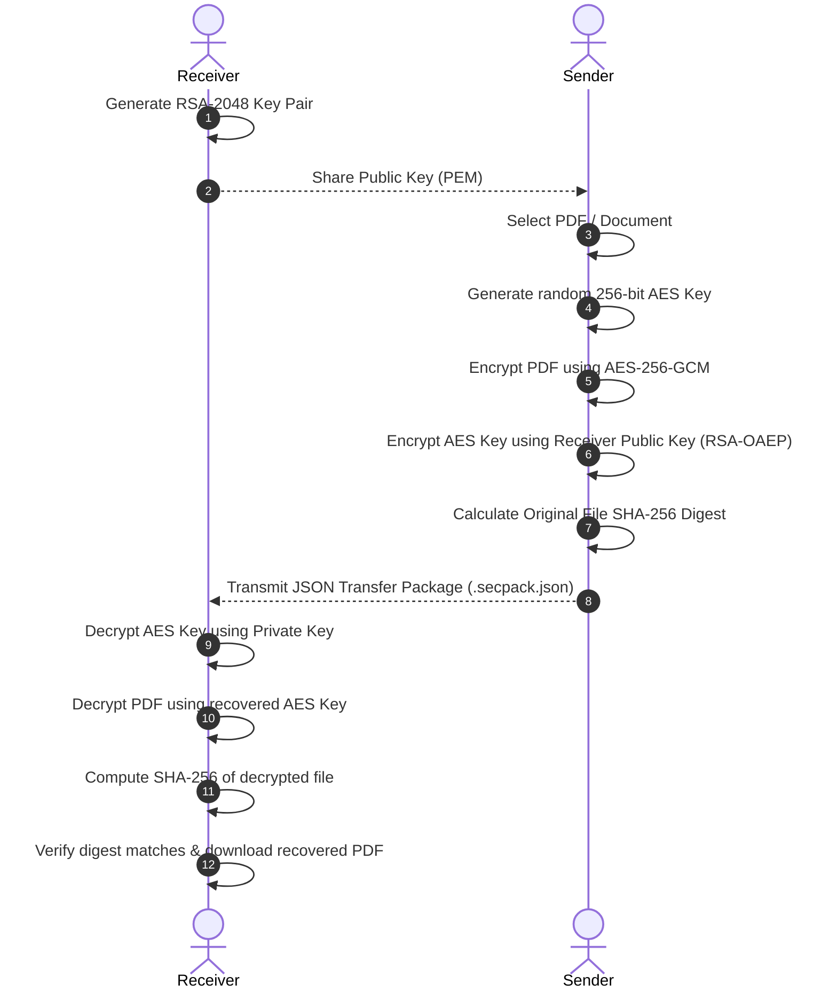

# OpenSSL CNS Project – Complete Presentation & Viva Guide

---

## 1. Introduction to OpenSSL

### 🎙️ Presentation Opening Speech:
> *"Good morning everyone. Our project is based on **OpenSSL**, a popular open-source cryptography and network security toolkit. It provides different security functions such as encryption, decryption, hashing, digital certificates, and secure communication using TLS."*

### What is OpenSSL?
OpenSSL is a software toolkit that helps protect information and secure communication over networks.
It supports:
- **AES**: Symmetric encryption for bulk data confidentiality.
- **RSA**: Asymmetric encryption for key encapsulation and digital signatures.
- **SHA-256**: Cryptographic hashing for integrity verification.
- **TLS**: Transport Layer Security for encrypted client-server network sessions.

### Why do we need OpenSSL?
We need security to protect sensitive data from unauthorized access (confidentiality), detect modifications or tampering (integrity), authenticate identities (authentication), and establish secure channels over untrusted public networks.

---

## 2. Experiment 1 – AES-256-CBC Symmetric Encryption

### Concept:
- **AES** stands for *Advanced Encryption Standard*.
- It is a **symmetric encryption algorithm**: the exact same secret key (derived from a password) is used for both encryption and decryption.
- Key size: 256 bits (32 bytes).
- Mode of operation: **CBC (Cipher Block Chaining)**, where each plaintext block is XORed with the preceding ciphertext block before encryption.

### Steps to Demonstrate:
1. Open the AES experiment folder in Command Prompt: `cd 01_AES_Encryption`
2. Display the original message:
   ```cmd
   type message.txt
   ```
3. Encrypt the file using AES-256-CBC:
   ```cmd
   openssl enc -aes-256-cbc -salt -pbkdf2 -iter 100000 -in message.txt -out encrypted.bin
   ```
4. Enter password when prompted (e.g., `SecretPass123`).
5. Open the encrypted file and observe that it is scrambled binary data:
   ```cmd
   type encrypted.bin
   ```
6. Decrypt the file using the same password:
   ```cmd
   openssl enc -d -aes-256-cbc -pbkdf2 -iter 100000 -in encrypted.bin -out decrypted.txt
   ```
7. Compare the original and decrypted files:
   ```cmd
   fc /b message.txt decrypted.txt
   ```

### Explain the Working to the Examiner:
- **AES-256** uses a 256-bit encryption key providing $2^{256}$ keyspace, immune to brute-force attacks.
- **CBC Mode** ensures that identical plaintext blocks encrypt into different ciphertext blocks.
- **PBKDF2** (Password-Based Key Derivation Function 2) derives the 256-bit key from the password.
- **Salt** adds 8 bytes of cryptographic randomness to prevent rainbow table attacks.
- **100,000 iterations** slow down dictionary and GPU cracking attempts.

### Expected Result:
```
Comparing files message.txt and DECRYPTED.TXT
FC: no differences encountered
```
*Significance:* Proves the decrypted file is 100% bit-for-bit identical to the original file.

---

## 3. Experiment 2 – RSA-2048 Asymmetric Cryptography

### Concept:
- **RSA** (Rivest–Shamir–Adleman) is an **asymmetric encryption algorithm**.
- Unlike AES, RSA uses a mathematically linked **key pair**:
  - **Public Key**: Shared openly with anyone; used by senders to encrypt messages or verify signatures.
  - **Private Key**: Kept strictly secret by the receiver; used to decrypt messages or generate signatures.

### Steps to Demonstrate:
1. Open RSA folder: `cd 02_RSA_Cryptography`
2. Generate an RSA-2048 private key:
   ```cmd
   openssl genpkey -algorithm RSA -out private.pem -pkeyopt rsa_keygen_bits:2048
   ```
3. Extract the public key:
   ```cmd
   openssl pkey -in private.pem -pubout -out public.pem
   ```
4. Display original message: `type message.txt`
5. Encrypt the message using the Public Key (RSA-OAEP with SHA-256):
   ```cmd
   openssl pkeyutl -encrypt -pubin -inkey public.pem -in message.txt -out encrypted.bin -pkeyopt rsa_padding_mode:oaep -pkeyopt rsa_oaep_md:sha256
   ```
6. Decrypt the message using the Private Key:
   ```cmd
   openssl pkeyutl -decrypt -inkey private.pem -in encrypted.bin -out decrypted.txt -pkeyopt rsa_padding_mode:oaep -pkeyopt rsa_oaep_md:sha256
   ```
7. Compare original and decrypted messages:
   ```cmd
   fc /b message.txt decrypted.txt
   ```

### Explain the Working:
- Mathematical security relies on the hardness of factoring large prime numbers ($N = p \times q$).
- The public key encrypts; only the corresponding private key can decrypt.
- **OAEP** (Optimal Asymmetric Encryption Padding) prevents chosen-ciphertext attacks (e.g. Bleichenbacher padding attacks).
- **SHA-256** is the hash function used within OAEP mask generation.
- **Crucial Rule:** Never share the private key.

### Expected Result:
```
Comparing files message.txt and DECRYPTED.TXT
FC: no differences encountered
```

---

## 4. Experiment 3 – SHA-256 Hashing & Avalanche Effect

### Concept:
- **SHA** stands for *Secure Hash Algorithm*.
- **SHA-256** is a cryptographic hash function that transforms input of arbitrary size into a fixed-length 256-bit (64 hex character) digest.
- Hashing is strictly **one-way**: it cannot be decrypted to retrieve the original data.

### Steps to Demonstrate:
1. Open SHA folder: `cd 03_SHA256_Hashing`
2. Inspect original file: `type original.txt`
3. Generate and save original hash:
   ```cmd
   openssl dgst -sha256 original.txt > original_hash.txt
   type original_hash.txt
   ```
4. Tamper with the file by appending text:
   ```cmd
   echo Tampered data >> original.txt
   type original.txt
   ```
5. Generate and save modified hash:
   ```cmd
   openssl dgst -sha256 original.txt > modified_hash.txt
   type modified_hash.txt
   ```
6. Compare hashes using binary compare:
   ```cmd
   fc /b original_hash.txt modified_hash.txt
   ```

### Explain the Working:
- SHA-256 processes data in 512-bit message blocks through 64 rounds of non-linear logical functions.
- Even changing a single character causes the **Avalanche Effect**, altering >50% of the output digest bits.

### Expected Result:
`fc /b` reports extensive differences between `original_hash.txt` and `modified_hash.txt`. This demonstrates how hashing detects unauthorized file modification and ensures data integrity.

---

## 5. Experiment 4 – TLS 1.3 Secure Communication

### Concept:
- **TLS** stands for *Transport Layer Security*.
- Protocol used to secure communications between clients and servers (e.g. HTTPS).
- Provides **Confidentiality** (encryption), **Integrity** (AEAD protection), and **Authentication** (digital certificates).

### Steps to Demonstrate:
1. Open TLS folder: `cd 04_TLS_Secure_Communication`
2. Generate self-signed certificate and private key:
   ```cmd
   openssl req -x509 -newkey rsa:2048 -keyout server.key -out server.crt -days 365 -noenc -subj "/CN=localhost" -addext "subjectAltName=DNS:localhost,IP:127.0.0.1"
   ```
3. Inspect generated certificate:
   ```cmd
   openssl x509 -in server.crt -noout -subject -issuer -dates
   ```
4. **Window 1**: Start TLS server on port 4433:
   ```cmd
   openssl s_server -accept 4433 -cert server.crt -key server.key -www
   ```
5. **Window 2**: Connect TLS client:
   ```cmd
   openssl s_client -connect localhost:4433 -servername localhost -showcerts
   ```
6. Send HTTP request:
   ```http
   GET / HTTP/1.0
   ```
   *(Press Enter twice)*
7. Observe HTTP 200 OK server response.

### Handshake Result Analysis Table:
| Parameter | Result | Meaning |
| :--- | :--- | :--- |
| **TLS version** | `TLS 1.3` | Modern 1-RTT encrypted handshake protocol. |
| **Cipher suite** | `AES-256-GCM` | Authenticated symmetric cipher with zero padding oracle flaws. |
| **Server key** | `RSA 2048-bit` | Asymmetric key size for certificate identity. |
| **Key exchange** | `X25519MLKEM768` | Post-quantum hybrid Ephemeral Diffie-Hellman key exchange. |
| **HTTP response** | `200 OK` | Encrypted web response delivered successfully. |

### Explanation of Verify Return Code 18:
`Verify return code: 18 (self-signed certificate)`  
*Explanation:* The certificate was created locally without being signed by an external commercial Certificate Authority (CA). The cryptographic TLS handshake and encryption completed with 100% security, but the client notes the certificate authority is untrusted by default.

---

## 6. Real-World Application: Secure File Transfer (Hybrid Encryption)

### Why Hybrid Encryption?
- **RSA is slow** for bulk data and has strict size limits (max 190 bytes for RSA-2048 with OAEP).
- **AES is ultra-fast** and has no size limits, but requires a pre-shared key.
- **Hybrid Encryption** solves both: AES encrypts the file, and RSA encrypts only the small 32-byte AES key.

### Complete 12-Step Workflow:


---

## 7. Presentation Final Conclusion Speech

> *"Our project demonstrates four important security techniques using OpenSSL: symmetric encryption, asymmetric encryption, hashing, and secure network communication. We also demonstrated how AES, RSA, and SHA-256 work together in a secure file transfer application using Hybrid Encryption. Through these experiments, we understood how cryptography helps protect data, maintain integrity, and secure communication. Thank you!"*

---

## 8. Quick Revision Table Before Presentation

| Experiment | Main Concept | What to Remember |
| :--- | :--- | :--- |
| **AES-256-CBC** | Symmetric encryption | Same key for encryption and decryption; CBC mode + PBKDF2 salt. |
| **RSA-2048** | Asymmetric encryption | Public key encrypts, Private key decrypts; OAEP padding with SHA-256. |
| **SHA-256** | Cryptographic hashing | One-way fixed 256-bit digest; Avalanche Effect detects tampering. |
| **TLS 1.3** | Network security | Encrypted client-server channel; combines key exchange, AEAD, and certs. |
| **Secure File Transfer** | Hybrid encryption | RSA protects the AES key; AES protects the file; SHA-256 verifies integrity. |
